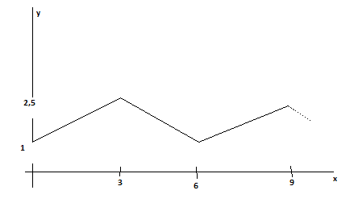
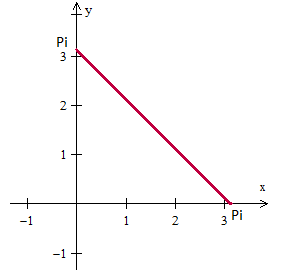
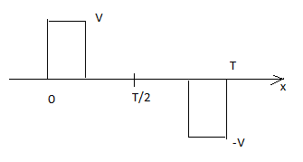

<!-- markdownlint-disable MD036 -->

# Series de Fourier

> Transcripción del original. Año de archivo: 2022. Atribución: Archivado en
> carpeta canónica de AMII; carrera no identificada en el documento. Las erratas
> y las repeticiones del original se conservan.

**Práctico Series de Fourier**

1\. Verifique que :

a. $`\int_{- \pi}^{\pi}{cosnx\ dx = 0}`$

b.$`\ \int_{- \pi}^{\pi}{sennx\ dx = 0}`$

c.$`\ \int_{- \pi}^{\pi}{sen(\ mx)\ cos(nx)\ dx = 0}`$

d.$`\ \int_{- \pi}^{\pi}{sen(mx)sen(nx)\ dx = 0}\ si\ m \neq n`$

e.$`\ \int_{- \pi}^{\pi}{sen(mx)sen(nx)\ dx = \pi}\ si\ m = n`$

f.$`\ \int_{- \pi}^{\pi}{\cos(mx)cos(nx)\ dx = 0}\ si\ m \neq n`$

g.$`\int_{- \pi}^{\pi}{\cos(mx)cos(nx)\ dx = \pi}\ si\ m = n`$

2\. Desarrolle en series de Fourier la función

```math
f(x) = \left\{ \begin{array}{r}
2\ \ \ si\ –\frac{\pi}{2} \lt  x \lt  \frac{\pi}{2} \\
0\ \ \ si\ \ \ \left\{ \begin{array}{r}
- \pi \lt  x \lt  - \frac{\pi}{2}\ \ o \\
\frac{\pi}{2} \lt  x \lt  \pi
\end{array} \right.\
\end{array} \right.
```

3\. Sea la función periódica del gráfico

y

1

10 20 x

Indique porqué la serie de Fourier contiene términos únicamente en coseno.

Indique como obtiene los coeficientes, calcule los primeros.

4\. Desarrollo de Fourier de los primeros sumandos de



5\. Sea la función periódica $`f(x) = x\ \ \ \  - \pi \lt  x \lt  \pi`$ cuyo
período es $`2\pi`$ y su desarrollo de Fourier
$`f(x) = 2\ \left( \frac{\sin x}{1} - \frac{\sin{2\ x}}{2} + \frac{\sin{3x}}{3} - \ \ldots \right)`$,
según los datos dados, obtenga el desarrollo de la función periódica
$`f(x) = x + 3\ \ \ \ \  - 0.5 \lt  x \lt  0.5`$ de período 1.

6\. Desarrollar en serie de Fourier la Función:

```math
f(x) = \left\{ \begin{array}{r}
\frac{\mathbf{1}}{\mathbf{2}}\mathbf{x}\mathbf{+}\mathbf{1}\mathbf{\ \ \ }\mathbf{si}\mathbf{\ \ }\mathbf{-}\mathbf{2}\mathbf{\leq}\mathbf{x} \lt  0 \\
\mathbf{0}\mathbf{\ \ \ \ \ \ \ \ \ \ \ }\mathbf{si}\mathbf{\ \ \ \ \ \ \ }\mathbf{0} \lt  x \leq 6 \\
\mathbf{de}\mathbf{\ }\mathbf{per}\mathbf{í}\mathbf{odo}\mathbf{\ }\mathbf{8}
\end{array} \right\}
```

7\. Encontrar la serie de cosenos para la función
$`f(x) = 1,\ si\ 0 \leq x \leq 2`$

Desarrollar en serie de Fourier, mostrar la gráfica para una aproximación de la
función de **$`n=5`$**.

8\. Desarrollar en serie de Fourier la función de período
**2**$`\mathbf{\pi\ ;\ \ \ \ f}\left( \mathbf{x} \right)\mathbf{= x + \ }\pi`$
definida en el intervalo ( $`\left( \mathbf{- \pi,\pi} \right)`$ . Mostrar el
gráfico de aproximación a la función de la serie obtenida para **$`n=4`$.**

```math
\mathbf{f}\left( \mathbf{x} \right)\mathbf{=}\left\{ \begin{array}{r}
\mathbf{- x\ \ \ \ \ \ \ \ \ \ \ \ \ \ \ \ \ \ \ \ si\ \ \ \ \ \ \ \ \  - \pi} \lt  x \leq 0 \\
\mathbf{\pi\ \ \ \ \ \ \ \ \ \ \ \ \ \ \ \ \ \ \ \ \ si\ \ \ \ \ \ \ \ \ \ \ \ \ \ 0} \lt  x \lt  \pi\  \\
\\
\mathbf{\ \ \ \ \ \ \ \ \ \ \ \ \ \ \ \ \ \ \ \ \ \ \ \ \ \ \ \ \ \ \ \ \ \ \ \ \ \ \ \ \ \ período\ 2}\mathbf{\pi}
\end{array} \right\}
```

9\. Desarrollar en serie de Fourier

```math
\mathbf{f}\left( \mathbf{x} \right)\mathbf{=}\left\{ \begin{array}{r}
\mathbf{0\ \ \ \ \ \ \ \ \ \ \ \ \ \ \ \ \ \ \ \ \ \ si\ \ \ \ \ \ \ \ \ \  - \pi \leq x} \lt  0 \\
\mathbf{- 2\ \ \ \ \ \ \ \ \ \ \ \ \ \ \ \ \ \ \ \ si\ \ \ \ \ \ \ \ \ \ \ \ \ \ 0 \leq x \leq}\frac{\mathbf{\pi}}{\mathbf{2}} \\
\mathbf{0\ \ \ \ \ \ \ \ \ \ \ \ \ \ \ \ \ \ \ \ si\ \ \ \ \ \ \ \ \ \ \ \ \ \pi/2} \lt  x \leq \pi\  \\
\\
\mathbf{\ \ \ \ \ \ \ \ \ \ \ \ \ \ \ \ \ \ \ \ \ \ \ \ \ \ \ \ \ \ \ \ \ \ \ \ \ \ \ \ \ \ período\ 2}\mathbf{\pi}
\end{array} \right\}
```

10\. Desarrollar en serie de Fourier la funciones:

a.

```math
\mathbf{f}\left( \mathbf{x} \right)\mathbf{=}\left\{ \begin{array}{r}
\mathbf{\ \ 0\ \ \ \ \ \ \ \ \ \ \ \ \ \ \ \ \ \ \ si\ \ \ \ \ \ \ \ \  - \pi \leq x} \lt  0 \\
\mathbf{sen\ x\ \ \ \ \ \ \ \ \ \ \ \ \ \ si\ \ \ \ \ \ \ \ \ \ \ \ 0 \leq x \leq \ \pi\ } \\
\\
\mathbf{\ \ \ \ \ \ \ \ \ \ \ \ \ \ \ \ \ \ \ \ \ \ \ \ \ \ \ \ \ \ \ \ \ \ \ \ \ \ \ \ \ \ período\ 2}\mathbf{\pi}
\end{array} \right\}
```

b.

```math
\mathbf{f}\left( \mathbf{x} \right)\mathbf{=}\left\{ \begin{array}{r}
\mathbf{0\ \ \ \ \ \ \ \ \ \ \ \ \ \ \ \ \ \ \ \ si\ \ \ \ \ \ \ \ \  - \pi} \lt  x \leq 0 \\
\mathbf{x}^{\mathbf{2}}\mathbf{\ \ \ \ \ \ \ \ \ \ \ \ \ \ \ \ \ \ \ \ si\ \ \ \ \ \ \ \ \ \ \ \ \ \ 0} \lt  x \lt  \pi\  \\
\\
\mathbf{\ \ \ \ \ \ \ \ \ \ \ \ \ \ \ \ \ \ \ \ \ \ \ \ \ \ \ \ \ \ \ \ \ \ \ \ \ \ \ \ \ \ período\ 2}\mathbf{\pi}
\end{array} \right\}
```

Un vez obtenida la serie, asignar a **x el valor 0.**

11\. Dada la siguiente función:



a) Grafique la función utilizando un graficador.

b) Encuentre las expresiones de las series COSENO y SENO de Fourier para
extensiones periódicas PAR e IMPAR de la función respectivamente. Grafique por
separado cada una para $`n=2`$ y compárelas con la función original.

c) Realice la extensión periódica de la función original (de período π) y
grafíquela. Encuentre la serie de Fourier de la misma y grafíquela para $`n=3`$.

d) Calcule la serie de Fourier para una función de igual período y pendiente,
con componente constante nula y centrada en el origen. Una vez encontrada la
serie de Fourier para esta nueva función grafíquela y luego adáptela para que
converja a la función original (modificando su componente constante y la fase de
sus componentes sinusoidales). Grafique la serie para $`n=3`$ después de la
adaptación.

e) Observando todo lo anterior saque sus conclusiones acerca de los distintos
medios para la obtención de una serie y como son sus convergencias dentro y
fuera del intervalo en cuestión.

Siendo

```math
f(x) = \left\{ \begin{array}{r}
x + \frac{\pi}{2}\ \ \  - \pi \lt  x \lt  0 \\
- x + \frac{\pi}{2}\ \ 0 \lt  x \lt  \pi
\end{array} \right.
```

con $`f(x) = f(x + 2\pi)`$, expresable como

$`f(x) = \frac{4}{\pi}(\cos x + \frac{1}{3^{2}}\cos{3x} + \frac{1}{5^{2}}\cos{5x\ } + \ldots)`$.
Si considera necesario puede utilizar los datos dados para expresar el
desarrollo de

```math
h(t) = \left\{ \begin{array}{r}
t + 1\ \ \ \ \  - 1 \lt  t \lt  0 \\
- t + 1\ \ 0 \lt  t \lt  1
\end{array} \right.
```

con $`h(t + 2) = h(t)`$

Describa los aspectos teóricos básicos necesarios para obtener el desarrollo de
Fourier del ejemplo dado.

12\. Desarrollar en serie de Fourier la siguiente funciones:

a.

```math
\mathbf{f}\left( \mathbf{x} \right)\left\{ \begin{array}{r}
\mathbf{0\ \ \ \ \ si\ \ \ \ \ \ \  - 2} \lt  x \lt  0 \\
\mathbf{x\ \ \ \ \ \ \ si\ \ \ \ \ \ \ \ \ \ \ 0} \lt  x \lt  2 \\
\\
\mathbf{de\ período\ \ 2}\mathbf{L = 4}
\end{array} \right\}
```

b. $`f(x) = - x\ \ \ si - 3 \lt  x \lt  3,\ \ \ \ 2L = 6`$

c.

```math
\mathbf{f}\left( \mathbf{x} \right)\left\{ \begin{array}{r}
\mathbf{- senx\ \ \ \ si\ \ \ \ \ \ \  -}\frac{\mathbf{\pi}}{\mathbf{4}}\mathbf{\lt }x \lt  0 \\
\mathbf{\cos}{\mathbf{4}\mathbf{x}}\mathbf{\ \ \ \ \ \ si\ \ \ \ \ \ \ \ \ \ \ 0} \lt  x \lt  \frac{\mathbf{\pi}}{\mathbf{4}} \\
\\
\mathbf{de\ período\ }\frac{\mathbf{\pi}}{\mathbf{2}}
\end{array} \right\}
```

13\. La función es de periodo T constituida por dos pulsos anti simétricos de
ancho $`\tau`$ , y la amplitud pico – pico es simétrica al eje x y vale 2V. Con
$`\left( 0 \leq \tau \leq \frac{T}{2} \right)`$ . Indique el desarrollo de
Fourier considerando la variación de $`\tau`$


