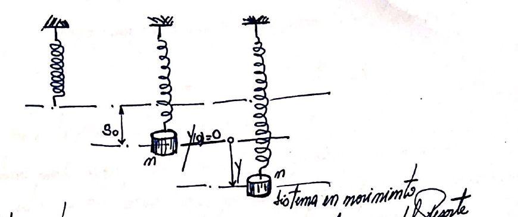
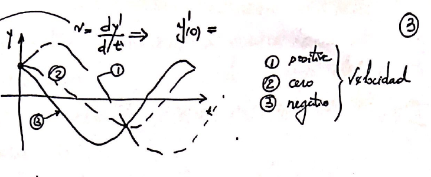
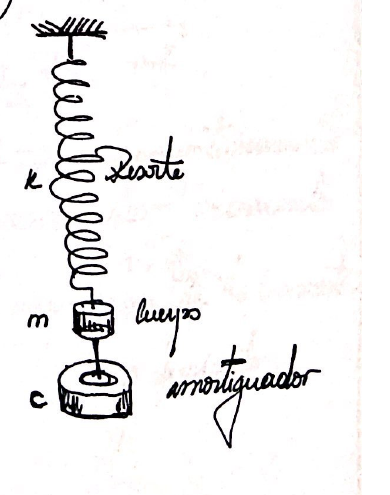
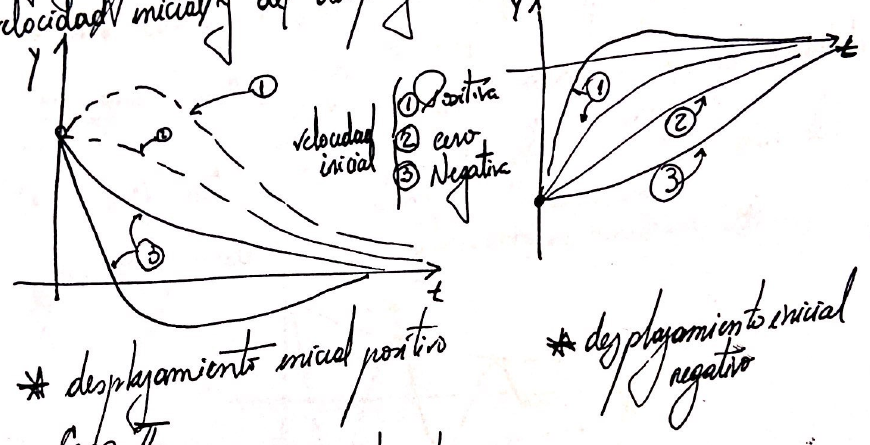
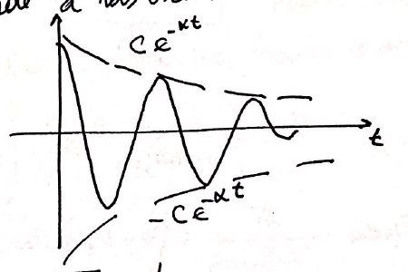
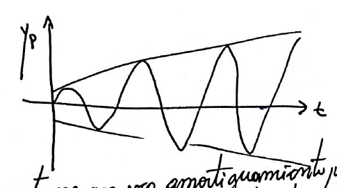
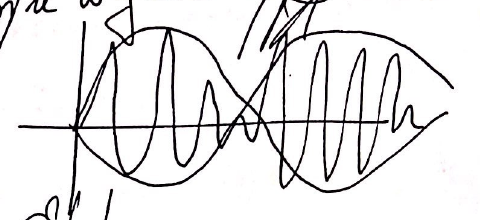
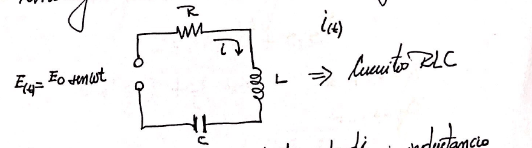

# Sistema masa resorte

> Fuente: `2022 [Intensivo]/CamScanner 11-08-2020 19.01-3.pdf`. Archivo de 2022;
> sin año impreso. Procedencia y controles en
> [cobertura PDF 2022](../../../resources/2022/pdf2022-cobertura.md).

## Página 1



Supuestos:

- $`m`$ es tan grande que despreciamos la masa del resorte.
- El cuerpo tira hacia abajo y se mueve solamente en sentido vertical.
- Se desprecia la resistencia del aire.

Se desea determinar el movimiento para ello tenemos que encontrar $`y(t)`$ es
decir la función que describe el movimiento en función del tiempo: es decir el
desplazamiento en función del tiempo.

Se elige la dirección hacia abajo como positiva, es decir las fuerzas hacia
abajo serán positivas y hacia arriba negativas.

```math
\downarrow\quad\bar F_1=m\cdot g
```

(atracción de la gravedad sobre la masa).

La fuerza del resorte será por la ley de Hooke:

```math
\uparrow\quad\bar F_2=-K\cdot s.
```

$`K`$: módulo del resorte; $`s`$: desplazamiento. Va hacia arriba.

## Página 2

Si $`s=1\Rightarrow\bar F_2=-K`$; entre más rígido sea el resorte mayor será el
valor de $`K`$.

En reposo

```math
\bar F_1+\bar F_2=m\cdot g-Ks_0=0.
```

$`s_0`$ es la posición de reposo o equilibrio.

Ahora para llegar a la posición $`s_0`$ el resorte oscila alrededor de $`s_0`$
con una fuerza que por la ley de Hooke se describe una $`y(t)`$. Por lo que las
fuerzas que actúan sobre la $`y(t)`$ serán:

```math
\bar F_1+\bar F_2-Ky=-Ky.
```

Por la segunda ley de Newton $`(F=m\cdot a)`$ esta fuerza será siendo
$`a=\frac{d^2y}{dt^2}`$:

```math
m\frac{d^2y}{dt^2}=my''=-Ky,
```

```math
my''+Ky=0.
```

Y esta es la EDO de un sistema masa resorte no amortiguado. Hallando la
homogénea:

```math
mr^2+K=0\Rightarrow r_{1,2}=\pm\sqrt{-\frac Km},
\qquad r_{1,2}=\pm\sqrt{\frac Km}\cdot i.
```

Si llamamos $`\sqrt{\frac Km}=\omega_0`$:

```math
\boxed{y(t)=A\cos\omega_0t+B\mathop{\mathrm{sen}}\nolimits \omega_0t}\qquad(1)
```

Oscilación armónica.

## Página 3



$`v=\frac{dy}{dt}\Rightarrow y'(0)=`$ \[sin completar en ese renglón del
original\].

1: positiva; 2: cero; 3: negativa — velocidad.

```math
y'(t)=-A\omega_0\mathop{\mathrm{sen}}\nolimits \omega_0t+B\omega_0\cos\omega_0t,
```

```math
y'(0)=B\omega_0\Rightarrow\text{se elimina el valor de }B.
```

Aplicando la fórmula de la suma para el coseno:

```math
A\cos\omega_0t+B\mathop{\mathrm{sen}}\nolimits \omega_0t
=\sqrt{A^2+B^2}\cos(\omega t-\delta),
```

donde podemos decir de $`C=\sqrt{A^2+B^2}`$;
$`\mathop{\mathrm{tg}}\nolimits \delta=\frac BA`$.

Así (1) la podemos escribir como

```math
\boxed{y(t)=C\cos(\omega_0t-\delta)}\qquad(2).
```

El período de la función trigonométrica de (1) ó de (2) es $`2\pi/\omega`$, el
cuerpo ejecuta $`\omega_0/2\pi`$ ciclos por segundo, la cantidad
$`\omega_0/(2\pi)`$ frecuencia de oscilación y se mide en Hertz o ciclos por
segundo.

### Sistema amortiguado

La masa se conecta a un amortiguador viscoso que genera una fuerza que es
opuesta al movimiento y proporcional a la velocidad $`y'=\frac{dy}{dt}`$; esto
es válido para velocidades pequeñas, así:

```math
\bar F_3=-cy'.
```



## Página 4

$`c`$ es positiva, si el cuerpo se mueve hacia abajo y la velocidad es positiva,
la fuerza del amortiguador es negativa porque va hacia arriba y viceversa. Así:

```math
\bar F_1+\bar F_2+\bar F_3=-Ky-cy',
\qquad my''=-Ky-cy'.
```

```math
my''+cy'+Ky=0\qquad(3).
```

Dividiendo ambos miembros por $`m`$:

```math
y''+\frac cm y'+\frac Km y=0\qquad(4).
```

Y la ecuación característica

```math
\lambda^2+\frac cm\lambda+\frac Km=0,
```

```math
\lambda_{1,2}=-\frac c{2m}\pm\frac1{2m}\sqrt{c^2-4mK}.
```

```math
\lambda_1=-\alpha+\beta,\qquad\lambda_2=-\alpha-\beta,
\qquad\alpha=\frac c{2m},\quad\beta=\frac1{2m}\sqrt{c^2-4mK}.
```

- Caso I. $`c^2\gt 4mK`$: raíces reales y distintas ⇒ Sobreamortiguamiento.
- Caso II. $`c^2=4mK`$: raíces reales iguales ⇒ Amortiguamiento crítico.
- Caso III. $`c^2\lt 4mK`$: raíces complejas conjugadas ⇒ Sub amortiguamiento.

## Página 5

### Caso I

```math
y(t)=C_1e^{-(\alpha-\beta t)}+C_2e^{-(\alpha+\beta t)}\qquad(4).
```

Sabemos que $`\alpha\gt 0`$; $`\beta\gt 0`$ y
$`\beta^2=\alpha^2-K/m\lt \alpha^2`$.

Por lo tanto ambos términos de (4) tienden a cero, es decir a la posición de
equilibrio estático, esto se debe a que el amortiguamiento toma energía del
sistema y no hay ninguna fuerza que aporte al movimiento. La forma depende de la
velocidad inicial y del desplazamiento inicial.



Velocidad inicial: 1 positiva, 2 cero, 3 negativa.

### Caso II

Amortiguamiento crítico:

```math
c^2=4mK\Rightarrow\beta=0,\quad\lambda_1=\lambda_2=-\alpha,
```

```math
y(t)=(C_1+C_2t)e^{-\alpha t}.
```

Es similar al caso I.

### Caso III

Este es el caso más interesante ya que si $`c`$ es pequeña
$`c^2\lt 4mK\Rightarrow
\beta`$ es imaginario puro.

```math
\beta=i\omega^*\Rightarrow
\omega^*=\frac1{2m}\sqrt{4mK-c^2}=\sqrt{\frac Km-\frac{c^2}{4m^2}}\gt 0.
```

Así

```math
\lambda_1=-\alpha+i\omega^*,\qquad\lambda_2=\alpha-i\omega^*.
```

## Página 6

Y la solución general es:

```math
\boxed{y(t)=e^{-\alpha t}(A\cos\omega^*t+B\mathop{\mathrm{sen}}\nolimits \omega^*t)},
```

```math
y(t)=Ce^{-\alpha t}\cos(\omega^*t-\delta),
\qquad C=\sqrt{A^2+B^2},\quad\mathop{\mathrm{tg}}\nolimits \delta=\frac BA.
```

Dado que $`\cos(\omega^*t-\delta)`$ varía entre 1 y -2 la curva solución estará
contenida entre $`y=Ce^{-\alpha t}`$ y $`y=-Ce^{-\alpha t}`$.

Ya que $`\omega^*=\sqrt{\frac Km-\frac{c^2}{4m^2}}`$ será más grande a medida
que menor sea $`c`$ y serán más rápidas las oscilaciones.

Si $`c\to0`$, $`\omega^*\to\omega_0=\sqrt{K/m}`$, que corresponde a las
oscilaciones armónicas, ver (1).



### Oscilaciones Forzadas

Si el movimiento es libre ⇒ $`my''+cy'+Ky=0`$.

Si actúa una fuerza externa $`r(t)`$ los movimientos son forzados, así

```math
my''+cy'+Ky=r(t).
```

$`r(t)`$ → fuerza de entrada o impulsora, a la solución se llama salida o
respuesta. Es de particular interés si

```math
r(t)=F_0\cos\omega t.
```

## Página 7

Y esta ecuación la resolvemos por ejemplo por coef. indeterminados:

```math
my''+cy'+Ky=F_0\cos\omega t.
```

Proponemos

```math
y_P(t)=a\cos\omega t+b\mathop{\mathrm{sen}}\nolimits \omega t,
```

donde

```math
a=F_0\frac{K-m\omega^2}{(K-m\omega^2)^2+\omega^2c},
\qquad b=F_0\frac{\omega c}{(K-m\omega^2)^2+\omega^2c^2}.
```

Sabemos que $`\sqrt{K/m}=\omega_0\gt 0`$:

```math
a=F_0\frac{m(\omega_0^2-\omega^2)}{m^2(\omega_0^2-\omega^2)^2+\omega^2c^2},
\qquad b=F_0\frac{\omega c}{m^2(\omega_0^2-\omega^2)^2+\omega^2c^2}.
```

```math
\boxed{y(t)=y_C(t)+y_P(t)}.
```

### Caso 1: Oscilaciones forzadas no amortiguadas

Reconozcamos los casos.

Si $`c=0\Rightarrow b=0`$:

```math
y_P(t)=\frac{F_0}{m(\omega_0^2-\omega^2)}\cos\omega t
=\frac{F_0}{K(1+(\omega/\omega_0)^2)}\cos\omega t.
```

```math
y(t)=C\cos(\omega_0t-\delta)+\frac{F_0}{m(\omega_0^2-\omega^2)}\cos\omega t.
```

$`\omega_0`$ es la frecuencia natural. $`\omega`$ es la frecuencia de la
entrada.

Así la $`y_P`$ máxima se daría cuando límite de $`\omega\to\omega_0`$.

```math
a_0=\frac{F_0}K\quad\longrightarrow\quad\text{Resonancia},
\qquad f=\frac1{1-(\omega/\omega_0)^2}.
```

En el caso de la Resonancia:

```math
y''+\omega_0^2y=\frac{F_0}m\cos\omega_0t.
```

## Página 8



Los sistemas con poco amortiguamiento pueden sufrir vibraciones que destruyan el
sistema.

Si la diferencia entre $`\omega`$ y $`\omega_0`$ es muy pequeña se obtienen
pulsaciones.



### Modelado de Circuitos Eléctricos

Partiendo de lo que hemos visto podemos hacer una analogía entre los circuitos
mecánicos y eléctricos:



$`E(t)=E_0\mathop{\mathrm{sen}}\nolimits \omega t`$; $`i(t)`$; circuito RLC.

Sabemos que:

```math
E_L=Li'=L\frac{di}{dt}\quad\text{inductancia},
\qquad E_R=Ri\quad\text{resistencia},
\qquad E_C=\frac1C\int i\,dt\quad\text{capacitor}.
```

Por ley de Kirchhoff:

```math
Li'+Ri+\frac1C\int i\,dt=E_0\mathop{\mathrm{sen}}\nolimits \omega t.
```

Derivando:

```math
Li''+Ri'+\frac1Ci=E_0\omega\cos\omega t.
```

## Página 9

```math
i=i_C(t)+i_P(t),\qquad i_P=a\cos\omega t+b\mathop{\mathrm{sen}}\nolimits \omega t.
```

Resolviendo por coef. ind.

```math
a=-\frac{E_0S}{R^2+S^2},\qquad b=\frac{E_0R}{R^2+S^2}.
```

$`S=`$ Reactancia.

```math
\boxed{S=\omega L-\frac1{\omega C}}.
```

$`i_P`$ la podemos escribir utilizando el teorema de la suma del coseno:

```math
I_P(t)=I_0\mathop{\mathrm{sen}}\nolimits (\omega t-\theta),
```

donde

```math
I_0=\sqrt{a^2+b^2}=\frac{E_0}{\sqrt{R^2+S^2}},
\qquad\mathop{\mathrm{tg}}\nolimits \theta=-\frac ab=\frac SR.
```

```math
\sqrt{R^2+S^2}=\sqrt{R+\left(\omega L-\frac1{\omega C}\right)}
\quad\Rightarrow\text{impedancia}.
```

Y la solución general de la homogénea será:

```math
I_h=C_1e^{\lambda_1t}+C_2e^{\lambda t},
```

```math
\lambda^2+\frac RL\lambda+\frac1{LC}=0,
\quad\lambda_1=-\alpha+\beta,\quad\lambda_2=-\alpha-\beta,
```

```math
\alpha=\frac R{2L},\qquad\beta=\frac1{2L}\sqrt{R^2-\frac{4L}C}.
```

La corriente $`i`$ tiende a la $`i_P`$ al cabo de un determinado tiempo.

**La transitoria tiende a la Permanente.**

Scanned with CamScanner (pie presente en las nueve páginas).

## Notas de transcripción

Se conservan las erratas visibles del manuscrito, entre ellas: la ubicación de
$`t`$ en los exponentes del caso I; el signo de $`\alpha`$ en $`\lambda_2`$ del
caso III; «varía entre 1 y -2»; el primer denominador del coeficiente $`a`$ sin
cuadrado en $`c`$; el signo $`+`$ de $`1+(\omega/\omega_0)^2`$; la expresión de
impedancia sin cuadrados en el segundo radical; y el segundo exponente
$`\lambda t`$ sin subíndice. No se han corregido ni utilizado para resolver
ejercicios.
